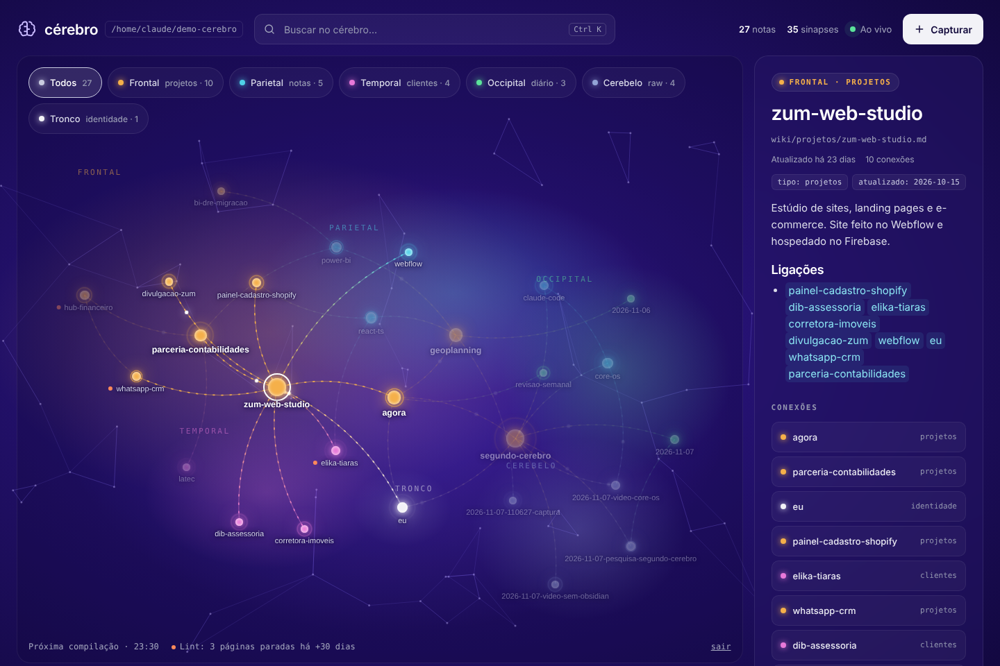

# Auren · Segundo cérebro

Segundo cérebro com Claude Code numa VPS: arquivos `.md` que o Claude lê e mantém,
compilação automática toda noite e um painel web ao vivo com o grafo das notas.



## Instalar na VPS

```bash
ssh root@SEU_IP
git clone https://github.com/luizsalves/auren-cerebro.git /root/auren-cerebro
sudo bash /root/auren-cerebro/instalar.sh
```

O instalador pede a senha do painel e no fim mostra o endereço (`http://SEU_IP:3333`).

Com domínio (HTTPS automático): aponte o DNS para o IP da VPS e rode
`DOMINIO=cerebro.seudominio.com.br sudo bash /root/auren-cerebro/instalar.sh`.

Depois:

```bash
cd /root/cerebro
claude          # faça login na primeira vez
/entrevista     # popula o cérebro com suas respostas
```

Para atualizar: `cd /root/auren-cerebro && git pull && sudo bash instalar.sh`.
As suas notas nunca são sobrescritas.

## Arquitetura

```
/root/cerebro/                  ← o cérebro (repositório git próprio)
├── CLAUDE.md                   mapa + regras (lido em toda sessão)
├── AGENTS.md → CLAUDE.md       para Codex e outros agentes
├── agora.md                    foco atual (importado no CLAUDE.md)
├── _indice.md                  índice da wiki
├── identidade/                 quem você é (só você escreve)
├── raw/                        entrada bruta, append-only
├── wiki/
│   ├── projetos/  clientes/  pessoas/  notas/
│   └── decisoes.md
├── diario/                     AAAA-MM-DD.md + revisões semanais
├── agentes/                    _modelo/, orquestrador/, arbitro/ e os seus (agente.md, conhecimento, exemplos, avaliacao, pendencias, execucoes/, ferramentas/)
├── _arquivo/                   nada é apagado, vem pra cá
└── .claude/
    ├── settings.json           hooks
    ├── rules/                  raw.md, wiki.md, pessoas.md (carregam por pasta)
    ├── skills/                 capturar, compilar, revisao-semanal, lint, entrevista, agentes, agente, novo-agente, avaliar, despachar
    ├── hooks/                  inicio.sh, protege.js, salvar.sh
    ├── motor.env               MOTOR=claude|ollama|simulado, modelos, orçamento (fora do git)
    └── scripts/                lint.js, rotina.sh, guarda-raw.sh, ligar-projetos.sh, rodar-agente.sh, motor.sh, motor-ollama.js, avaliar-agente.sh, agendar-agentes.sh, agentes-lib.js, registrar-sessao.sh

/opt/cerebro-painel/            ← painel web (Node, sem dependências)
/etc/cerebro-painel.env         ← senha e configuração (só root lê)
/etc/cron.d/cerebro             ← rotinas
```

### Camadas

| Camada | Quem escreve | Regra |
|---|---|---|
| `identidade/` | você | o Claude só mexe se você pedir |
| `raw/` | você / Claude / painel | só cria; editar é bloqueado por hook e revertido pelo git |
| `wiki/` | Claude via `/compilar` | toda afirmação cita a fonte em `raw/` |
| `diario/` | Claude | resumo de sessões, compilações e revisões |

### Hooks

- **SessionStart** (`inicio.sh`): injeta data, último diário, quantos `raw/` faltam compilar e o último lint.
- **PreToolUse** (`protege.js`): bloqueia editar arquivo existente em `raw/`.
- **Stop** (`salvar.sh`): restaura `raw/` se algo foi alterado e faz commit (histórico e backup).

### Projetos da VPS

`ligar-projetos.sh` lê as pastas `/opt/projetos` e `/opt/saas` (menos `secrets`) e, para cada
projeto: cria ou atualiza `wiki/projetos/<nome>.md` com um bloco **Na VPS** (caminho, stack,
git, última atividade, resumo do README), mantém o hub `wiki/notas/projetos-vps.md`, o
`_indice.md`, a tabela **Projetos na VPS** no `CLAUDE.md` e libera as pastas em
`permissions.additionalDirectories` para o Claude Code ler o código. O inventário entra em
`raw/` só quando algo muda. Páginas que você já escreveu são mantidas; só o bloco entre as
marcas `vps:inicio`/`vps:fim` é reescrito.

Roda no instalador e todo domingo 18:30. Na mão:
`bash /root/cerebro/.claude/scripts/ligar-projetos.sh`
(outras pastas: `PASTAS="/opt/projetos /srv/apps" EXCLUIR="secrets tmp" bash ...`).

### Agentes

Cada agente é uma pasta em `/root/cerebro/agentes/<nome>/`: `agente.md` (frontmatter com papel, status,
modelo, horário, ferramentas, comandos permitidos, efeitos externos, orçamento), `conhecimento.md`,
`exemplos.md`, `avaliacao.md`, `pendencias.md`, `execucoes/` e `ferramentas/` (o código que o agente
executa, um script por ação; `node_modules` fora do git). Um produto com deploy próprio continua em
`/opt/...` e o campo `codigo:` aponta para ele. Credenciais em `/etc/cerebro-agentes/<nome>.env`.

Papéis: **orquestrador** (Haiku, de hora em hora) lê `raw/` novo e pendências e despacha até 5
especialistas; **especialista** executa dentro de allowlists; **árbitro** (Haiku, só leitura) julga cada
rodada sem ver o raciocínio — reprovou, o especialista refaz uma vez, depois vira pendência sua.
Especialista não chama especialista; ninguém aprova a si mesmo; efeito externo fica "preparado para
aprovação".

Autonomia por agente (`autonomia:`): `leitura` só relata; `reversivel` altera o que dá para desfazer e
escreve "## Como reverter" no relatório; `critico` prepara ações (deploy, exclusão, mensagem) e você
aprova. Toda rodada automática roda isolada com `systemd-run` (sistema de arquivos só leitura; escrita
só na execução, em `pendencias.md`, em `raw/` e nos caminhos de `escreve_em:`; `/etc/cerebro-agentes`
inacessível). `rodar-agente.sh --testar-isolamento` confere. Métricas de rodadas (acertos, reprovações,
custo, tempo, isolamento) em `.claude/agentes/historico.jsonl`; botão **Agentes** no painel e
`agentes-lib.js desempenho` mostram o quadro.

Vem pronto o **ops-agent** (07:30, autonomia crítica): compara GitHub × VPS × máquina Windows em todos
os projetos, confere a saúde do cérebro (painel, compilação, raw pendente, disco, crons) e deixa os
deploys necessários preparados para aprovação. Ferramentas em `agentes/ops-agent/ferramentas/`.

**Conhecimento automático dos projetos:** o instalador registra um hook `SessionEnd` no Claude Code
(`~/.claude/settings.json`). Ao fechar uma sessão dentro de qualquer projeto em `/opt`, um `raw/` com
pedido inicial, arquivos editados, commits e resumo entra no cérebro e o `/compilar` leva para a página
do projeto. O `ligar-projetos.sh` também cria em cada projeto um `CLAUDE.md` (fora do git, via
`.git/info/exclude`) que importa a página dele no cérebro.

Quem roda é `.claude/scripts/rodar-agente.sh <nome> ["tarefa"]`, o único ponto que fala com o modelo.
Motor em `.claude/motor.env`: `MOTOR=claude` (login do Claude Code, sem API key), `MOTOR=ollama`
(`motor-ollama.js`, mesmas regras, servidor próprio) ou `MOTOR=simulado` (testa a instalação sem
gastar). Orçamento diário (`ORCAMENTO_DIA_USD`) e por rodada (`orcamento_rodada_usd`) bloqueiam
quando estouram. O hook `protege.js` impede o agente de editar o próprio conhecimento, `identidade/`,
`CLAUDE.md`, `.claude/` e `raw/` existente.

No Claude Code: `/agentes`, `/agente <nome>` (situação, rodar, aceitar/rejeitar pendências, avaliar),
`/novo-agente <nome>`, `/avaliar <nome>`, `/despachar`. No painel: lobo **Agentes**, botão **Rodar
agora** com log ao vivo e **Avaliar**. Horários vêm do campo `horario:` e viram
`/etc/cron.d/cerebro-agentes` (regenerado a cada 30 min por `agendar-agentes.sh`).

### Deploy pelo painel

Ao abrir um projeto no painel aparece o botão **Deploy**: ele roda `.claude/deploy/<slug>.sh`
na VPS (por padrão `git pull` + build/restart conforme a stack detectada; edite à vontade) e
deixa o mesmo deploy pendente para a sua máquina Windows. Log ao vivo no painel e uma linha
no `diario/` para cada máquina.

**Máquina Windows:** um agente em PowerShell pergunta ao painel a cada 20 s se há deploy
pendente e faz `git pull` (ou `deploy.ps1`/`deploy.cmd`, se existir) na pasta local do
projeto. Se a máquina estiver desligada, o pendente expira em 15 min (`AGENTE_EXPIRA_MIN`).
Instalação: painel → projeto → **Configurar a máquina Windows** (mostra o comando com URL e
token). As pastas locais ficam em `%USERPROFILE%\.cerebro\agente.json`.

### Rotinas (cron, horário do servidor)

| Quando | O quê | Modelo |
|---|---|---|
| domingo 18:30 | `ligar-projetos.sh` (sem IA) | — |
| de hora em hora | orquestrador dos agentes | haiku |
| `horario:` de cada agente | rodada do agente + árbitro | o do agente + haiku |
| todo dia 23:30 | `/compilar` | haiku (barato) |
| domingo 19:00 | lint (sem IA) | — |
| domingo 20:00 | `/revisao-semanal` | sonnet |

Log em `/root/cerebro/.claude/rotina.log`. Rodar na mão: `bash /root/cerebro/.claude/scripts/rotina.sh compilar`.

### Painel

- O grafo agrupa as notas por lobo: projetos (frontal), notas (parietal), clientes e pessoas (temporal), diário (occipital), raw (cerebelo) e identidade (tronco).
- Cada `[[link]]` vira uma sinapse, e o tamanho do neurônio cresce com o número de conexões.
- O painel atualiza sozinho quando um `.md` muda.
- Clique num neurônio para ler a nota e as conexões.
- **Capturar** salva direto em `raw/`.
- Ctrl+K busca.

Comandos úteis:

```bash
systemctl status cerebro-painel       # está rodando?
journalctl -u cerebro-painel -f       # logs
sudo nano /etc/cerebro-painel.env     # trocar senha → systemctl restart cerebro-painel
```

## Backup no GitHub (opcional)

O cérebro já é um repositório git. Para ter cópia fora da VPS, crie um repositório **privado**
e rode em `/root/cerebro`: `git remote add origin <url> && git push -u origin HEAD`.
