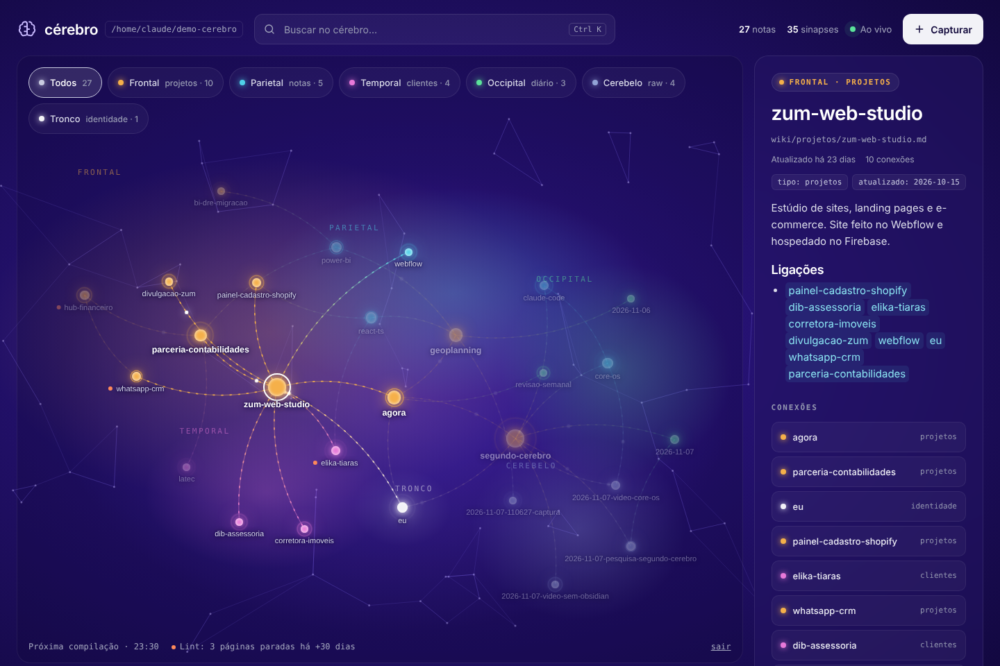

# Auren · Segundo cérebro

Segundo cérebro com Claude Code numa VPS: arquivos `.md` que o Claude lê e mantém,
compilação automática toda noite e um painel web ao vivo com o grafo das notas.



## Instalar na VPS

```bash
ssh root@SEU_IP
git clone https://github.com/luizsalves/auren-cerebro.git /root/auren-cerebro
sudo bash /root/auren-cerebro/instalar.sh
```

O instalador pede a senha do painel e no fim mostra o endereço (`http://SEU_IP:3333`).

Com domínio (HTTPS automático): aponte o DNS para o IP da VPS e rode
`DOMINIO=cerebro.seudominio.com.br sudo bash /root/auren-cerebro/instalar.sh`.

Depois:

```bash
cd /root/cerebro
claude          # faça login na primeira vez
/entrevista     # popula o cérebro com suas respostas
```

Para atualizar: `cd /root/auren-cerebro && git pull && sudo bash instalar.sh`.
As suas notas nunca são sobrescritas.

## Arquitetura

```
/root/cerebro/                  ← o cérebro (repositório git próprio)
├── CLAUDE.md                   mapa + regras (lido em toda sessão)
├── AGENTS.md → CLAUDE.md       para Codex e outros agentes
├── agora.md                    foco atual (importado no CLAUDE.md)
├── _indice.md                  índice da wiki
├── identidade/                 quem você é (só você escreve)
├── raw/                        entrada bruta, append-only
├── wiki/
│   ├── projetos/  clientes/  pessoas/  notas/
│   └── decisoes.md
├── diario/                     AAAA-MM-DD.md + revisões semanais
├── _arquivo/                   nada é apagado, vem pra cá
└── .claude/
    ├── settings.json           hooks
    ├── rules/                  raw.md, wiki.md, pessoas.md (carregam por pasta)
    ├── skills/                 capturar, compilar, revisao-semanal, lint, entrevista
    ├── hooks/                  inicio.sh, protege.js, salvar.sh
    └── scripts/                lint.js, rotina.sh, guarda-raw.sh

/opt/cerebro-painel/            ← painel web (Node, sem dependências)
/etc/cerebro-painel.env         ← senha e configuração (só root lê)
/etc/cron.d/cerebro             ← rotinas
```

### Camadas

| Camada | Quem escreve | Regra |
|---|---|---|
| `identidade/` | você | o Claude só mexe se você pedir |
| `raw/` | você / Claude / painel | só cria; editar é bloqueado por hook e revertido pelo git |
| `wiki/` | Claude via `/compilar` | toda afirmação cita a fonte em `raw/` |
| `diario/` | Claude | resumo de sessões, compilações e revisões |

### Hooks

- **SessionStart** (`inicio.sh`): injeta data, último diário, quantos `raw/` faltam compilar e o último lint.
- **PreToolUse** (`protege.js`): bloqueia editar arquivo existente em `raw/`.
- **Stop** (`salvar.sh`): restaura `raw/` se algo foi alterado e faz commit (histórico e backup).

### Rotinas (cron, horário do servidor)

| Quando | O quê | Modelo |
|---|---|---|
| todo dia 23:30 | `/compilar` | haiku (barato) |
| domingo 19:00 | lint (sem IA) | — |
| domingo 20:00 | `/revisao-semanal` | sonnet |

Log em `/root/cerebro/.claude/rotina.log`. Rodar na mão: `bash /root/cerebro/.claude/scripts/rotina.sh compilar`.

### Painel

- O grafo agrupa as notas por lobo: projetos (frontal), notas (parietal), clientes e pessoas (temporal), diário (occipital), raw (cerebelo) e identidade (tronco).
- Cada `[[link]]` vira uma sinapse, e o tamanho do neurônio cresce com o número de conexões.
- O painel atualiza sozinho quando um `.md` muda.
- Clique num neurônio para ler a nota e as conexões.
- **Capturar** salva direto em `raw/`.
- Ctrl+K busca.

Comandos úteis:

```bash
systemctl status cerebro-painel       # está rodando?
journalctl -u cerebro-painel -f       # logs
sudo nano /etc/cerebro-painel.env     # trocar senha → systemctl restart cerebro-painel
```

## Backup no GitHub (opcional)

O cérebro já é um repositório git. Para ter cópia fora da VPS, crie um repositório **privado**
e rode em `/root/cerebro`: `git remote add origin <url> && git push -u origin HEAD`.
